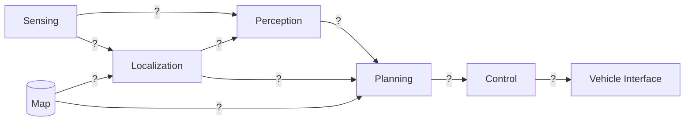

# Mimari Notları

## 1. Modüler stack (Autoware)

Her `?` yerine taşınan veriyi yaz. Eksik ya da fazla ok varsa düzelt; bu iskelet bilerek eksik.

### Arayüz tablosu

| Modül | Giriş | Çıkış | Tipik frekans | Başarısız olursa |
|---|---|---|---|---|
| Sensing | | | | |
| Perception | | | | |
| Localization | | | | |
| Planning | | | | |
| Control | | | | |
| Vehicle Interface | | | | |

## 2. VisionPilot

Kendin çiz. Kaynak: repo README'si, release notları, mimari görseli.

### Model → özellik tablosu

| Model | Ne tahmin ediyor | Hangi özelliği besliyor | Tek kare mi, ardışık kare mi? |
|---|---|---|---|
| | | | |

## 3. Sorular

**1. Modüler stack'te localization neden perception'dan ayrı bir modül? VisionPilot'ta karşılığı var mı?**

Perception, çevredeki nesneleri ve şeritleri araca göre konumlar; localization ise aracın dünyadaki, yani harita üzerindeki konumunu kestirir. İki modülün girdileri, çıktıları ve hata türleri farklı olduğu için ayrı tutulurlar; böylece her biri ayrı test edilip bağımsız olarak değiştirilebilir. Ayrıca algılanan nesneleri haritaya yerleştirebilmek için önce aracın kendi konumunun bilinmesi gerekir. VisionPilot'ta harita tabanlı ayrı bir localization modülü yoktur: algının ürettiği şeride göre konum (yanal sapma e_y ve yön hatası e_ψ) bu işlevi üstlenir.

**2. HD harita kullanan bir sistem ile haritasız tek kameralı sistem arasında ODD nasıl değişir?**

ODD, bir sistemin güvenle çalışmak üzere tasarlandığı koşulların tanımıdır. HD haritalı bir sistem yalnızca önceden haritalanmış ve haritası güncel bölgelerde çalışabilir; buna karşılık yol geometrisini önceden bildiği için şerit çizgileri silik olduğunda ya da görüş kötüleştiğinde daha dayanıklıdır. Haritasız tek kameralı sistem ise o an kameranın gördüğüne dayandığından şerit çizgileri görünen her yolda çalışabilir, ama ODD'si yağmur, gece, karşıdan gelen güneş ve silik çizgiler gibi görüş koşullarıyla daralır. Kısaca HD harita ODD'yi coğrafyayla, tek kamera ise görüş koşullarıyla sınırlar.

**3. Uçtan uca bir modelin hata ayıklaması modüler stack'e göre neden zor? VisionPilot bu zorluğu nasıl azaltıyor?**

Modüler stack'te her modülün çıktısı ayrı ayrı incelenebildiği için hatanın yanlış algılanan bir nesneden mi, yanlış konumdan mı yoksa yanlış plandan mı kaynaklandığı ayırt edilebilir. Uçtan uca yaklaşımda ise kameradan direksiyon komutuna kadar tek bir ağ vardır ve ara temsiller ağın içinde gizlidir; bu yüzden hatanın hangi aşamada oluştuğu doğrudan görülemez ve düzeltmek çoğu zaman yeni veriyle yeniden eğitim gerektirir. VisionPilot bu zorluğu, ağları çıktısı yorumlanabilir dar görevlere ayırarak azaltır: EgoLanes şerit çizgilerini, AutoSpeed öndeki en yakın nesneyi tahmin eder ve bu çıktılar klasik takip ve kontrol katmanına gider. Böylece bir hatanın algıdan mı yoksa kontrolden mi geldiği ayrılabilir.

**4. Öğrenilmiş algının çıktısı ile kontrolcü arasına neden klasik bir takip (filtre) katmanı koyulur?**

Öğrenilmiş modellerin çıktısı kareden kareye gürültülüdür; bazı karelerde şerit hiç bulunamayabilir ya da aykırı bir tahmin çıkabilir. Bu çıktı doğrudan kontrolcüye verilirse direksiyon titrer veya ani hareketler yapar. Kalman filtresi gibi bir takip katmanı ölçümleri aracın hareket modeliyle birleştirerek yumuşatır, kısa ölçüm kayıplarında tahminle boşluğu doldurur ve aykırı ölçümlerin ayıklanmasına yardım eder. Ayrıca kestirimin ne kadar güvenilir olduğunu (kovaryans) verir; sistem bu bilgiyle sürücüyü uyarmaya ya da özelliği kapatmaya karar verebilir.

**5. Control modülü planning'den daha yüksek frekansta çalışıyorsa bu neden mantıklı?**

Aracın durumu sürekli değişir: rüzgâr, yol eğimi ve sürtünme gibi bozucu etkiler küçük sapmalar yaratır ve bunların hızla düzeltilmesi gerekir. Planlamanın ürettiği yörünge ise birkaç saniye ileriyi kapsadığı için her döngüde yeniden hesaplanması gerekmez; üstelik planlama hesaplama açısından daha pahalıdır. Bu yüzden kontrol, elindeki en güncel yörüngeyi kullanarak daha sık çalışır ve planlama güncellemeleri arasında aracı yörüngede tutar. Katmanlar farklı hızlarda çalıştığından aralarındaki veri eşzamanlı gelmez; kontrol her döngüde en son gelen planı kullanır.

**6. L2 ile L4 arasındaki fark yazılım mimarisine nasıl yansır? (Sorumluluk kimde, fallback nedir?)**

SAE J3016'ya göre L2'de sistem direksiyonu ve hızı birlikte kontrol edebilir, ama sürüşü sürekli izlemek ve gerektiğinde müdahale etmek sürücünün sorumluluğundadır; yani fallback sürücüdür. Bu nedenle L2 mimarisinde sürücü izleme (eller direksiyonda mı, dikkat yerinde mi) ve kontrolü sürücüye devretme uyarıları önemlidir; sistem emin olmadığında kendini kapatabilir. L4'te ise tanımlı ODD içinde sorumluluk ve fallback sistemdedir: arıza ya da ODD dışına çıkma durumunda araç kendi başına güvenli bir duruma (minimal risk condition, ör. kenara çekip durmak) geçmelidir. Bu da yedekli sensör ve hesaplama, sürekli arıza ve ODD izleme gibi ek mimari bileşenler gerektirir.

Kaynak: SAE J3016, *Taxonomy and Definitions for Terms Related to Driving Automation Systems for On-Road Motor Vehicles*.
