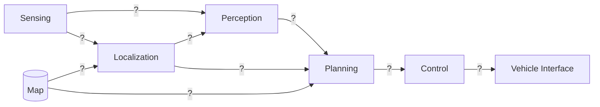

# Mimari Notları

## 1. Modüler stack (Autoware)

Her `?` yerine taşınan veriyi yaz. Eksik ya da fazla ok varsa düzelt; bu iskelet bilerek eksik.

### Arayüz tablosu

| Modül | Giriş | Çıkış | Tipik frekans | Başarısız olursa |
|---|---|---|---|---|
| Sensing | | | | |
| Perception | | | | |
| Localization | | | | |
| Planning | | | | |
| Control | | | | |
| Vehicle Interface | | | | |

## 2. VisionPilot

Kendin çiz. Kaynak: repo README'si, release notları, mimari görseli.

### Model → özellik tablosu

| Model | Ne tahmin ediyor | Hangi özelliği besliyor | Tek kare mi, ardışık kare mi? |
|---|---|---|---|
| | | | |

## 3. Sorular

1. Modüler stack'te localization neden perception'dan ayrı bir modül? VisionPilot'ta karşılığı var mı?
2. HD harita kullanan bir sistem ile haritasız tek kameralı sistem arasında ODD nasıl değişir?
3. Uçtan uca bir modelin hata ayıklaması modüler stack'e göre neden zor? VisionPilot bu zorluğu nasıl azaltıyor?
4. Öğrenilmiş algının çıktısı ile kontrolcü arasına neden klasik bir takip (filtre) katmanı koyulur?
5. Control modülü planning'den daha yüksek frekansta çalışıyorsa bu neden mantıklı?
6. L2 ile L4 arasındaki fark yazılım mimarisine nasıl yansır? (Sorumluluk kimde, fallback nedir?)
