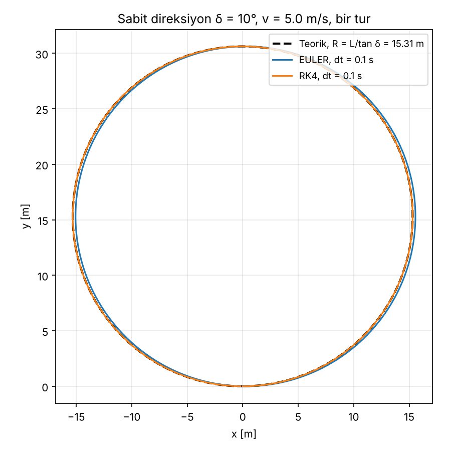
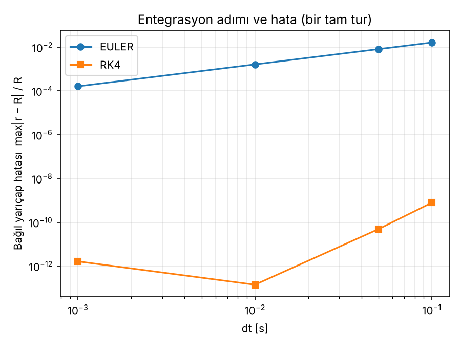

# 01 — Kinematik Bisiklet Modeli

## Öğrenme hedefi

Diğer tüm modüllerin üzerinde test edileceği **simülatörü** yazmak ve varsayımlarını bilmek.
Bu bir algoritma işidir: dört araba tekerleği iki tekerleğe indirgenir ve durum
`(x, y, yaw, v)` diferansiyel denklemlerle ilerletilir.

Modül sonunda şunları açıklayabilmelisin:
- Referans noktası arka aks mı, ağırlık merkezi mi? Seçim denklemleri nasıl değiştirir?
- Model hangi koşulda geçersizleşir? (Lastik kayması, yüksek yanal ivme.) Bu yüzden 02'deki testler hangi hız aralığında anlamlı?
- Euler ile RK4 entegrasyonu arasındaki fark ve `dt` seçiminin hataya etkisi

## Okumalar

- Kong ve ark. (2015), *Kinematic and Dynamic Vehicle Models for Autonomous Driving Control Design*
- Paden ve ark. (2016) survey: araç modelleri bölümü

## Arayüz (`src/bicycle.py`)

| Fonksiyon | Görev |
|---|---|
| `derivatives(state, accel, steer, params)` | `[ẋ, ẏ, ψ̇, v̇]` döndürür |
| `step(state, accel, steer, dt, params, method)` | Tek adım; `method` ∈ {`"euler"`, `"rk4"`}; direksiyon ve ivme sınırlanır, yaw `[-π, π]`'ye sarılır |
| `simulate(state0, accels, steers, dt, params, method)` | Dizi halinde kontrol girdisi alır, `(N+1, 4)` durum dizisi döner |

Referans noktası: **arka aks merkezi** (Pure Pursuit bu tanımı kullanır).

## Görevler

- [x] `derivatives` ve `step` (Euler) → testleri geçir
- [x] RK4 ekle
- [x] `results/circle.png`: sabit direksiyonla çember, teorik çember üst üste
- [x] `results/dt_error.png`: `dt` ∈ {0.001, 0.01, 0.05, 0.1} için Euler ve RK4 çember yarıçap hatası (log ölçek)
- [ ] `notes.md`: modelin geçersiz olduğu durumlar, kendi cümlelerinle

## Sonuçlar

Üretmek için (repo kökünden): `python 01-vehicle-model/src/plots.py`

Bir tam turda bağıl yarıçap hatası `max|r − R| / R` (δ = 10°, v = 5 m/s, R = 15,31 m):

| dt [s] | Euler | RK4 |
|---|---|---|
| 0,001 | 1,6e-4 | 1,6e-12 |
| 0,01 | 1,6e-3 | 1,4e-13 |
| 0,05 | 8,2e-3 | 4,9e-11 |
| 0,1 | 1,6e-2 | 7,9e-10 |

- Euler hatası `dt` ile doğrusal düşüyor (1. mertebe): `dt` 10 kat küçülünce hata 10 kat küçülüyor.
  Euler her adımda teğet boyunca gittiği için araç çemberin dışına doğru spiral çiziyor.
- RK4 hatası 4. mertebe; `dt ≤ 0,01`'de kayan nokta yuvarlama sınırına (~1e-13) iniyor. 0,001'de
  hatanın tekrar artması yuvarlama hatasının birikmesi (10 kat daha fazla adım), yöntem hatası değil.
- Pratik sonuç: 02–05'te `dt = 0,01–0,05` ile RK4, modelin kendisinin hatasından (kayma, lastik)
  çok daha küçük bir sayısal hata verir. Sayısal hata darboğaz değil.

## Kabul kriteri

- [x] `pytest 01-vehicle-model` tamamen yeşil
- [x] `circle.png` ve `dt_error.png` üretilmiş ve bu README'den link verilmiş
- [ ] `notes.md`'de "model ne zaman yanlış söyler" sorusuna en az 3 maddelik cevap var

## Yazı

→ `docs/writing-plan.md` #2
