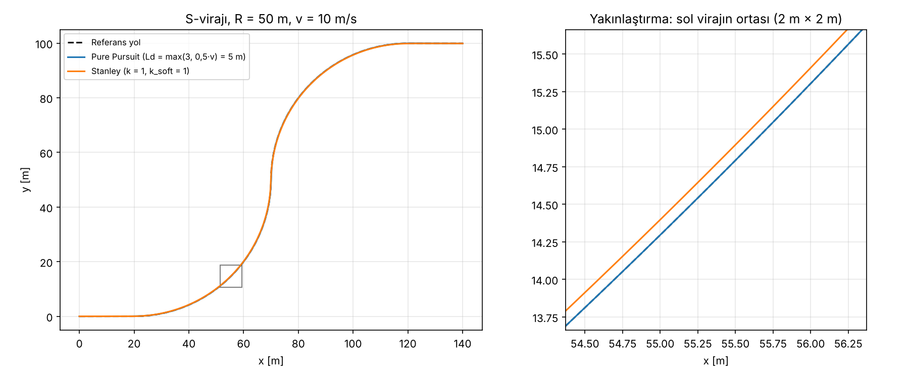
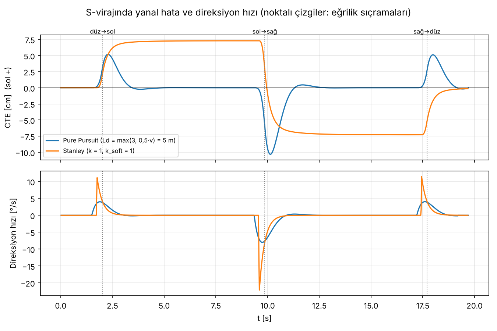
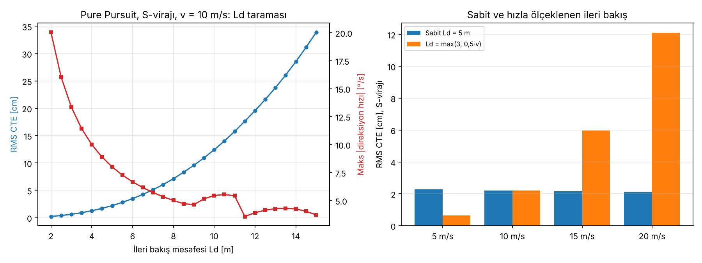
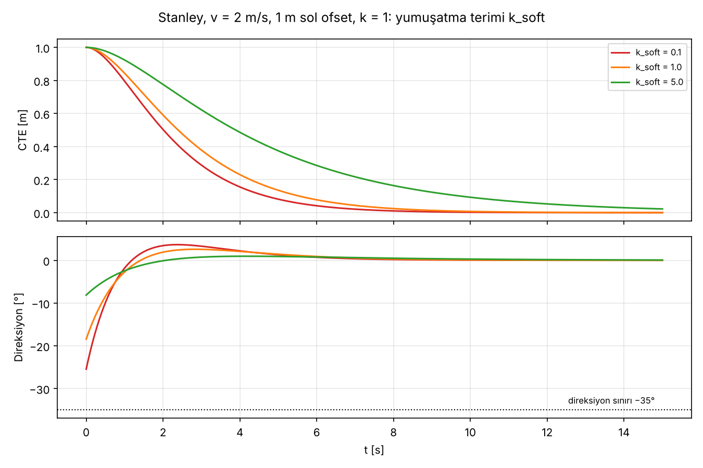

# 02 — Kontrol: PID, Pure Pursuit, Stanley

## Öğrenme hedefi

Aynı araç modeli (01) ve aynı referans yollar (`common`) üzerinde üç klasik kontrolcüyü
yazıp **ölçerek** karşılaştırmak:

- **PID**: boylamsal hız kontrolü (ACC'nin en basit hali)
- **Pure Pursuit**: geometrik yanal kontrol, ileri bakış noktasına yay çizer
- **Stanley**: yön hatası + yanal hata, ön aks referanslı

Modül sonunda şunları cevaplayabilmelisin:
- Pure Pursuit virajda neden içeri keser? Bu hatayı ileri bakış mesafesi nasıl değiştirir?
- Stanley düşük hızda neden sert davranır ve yumuşatma terimi ne işe yarar?
- Hızla ölçeklenen ileri bakış (`Ld = k·v`) neden sabit ileri bakıştan iyidir?
- Eğrilik süreksizliğinde (S-viraj geçişi) hangi kontrolcü nasıl bozulur?

## Okumalar

- Snider (2009), *Automatic Steering Methods for Autonomous Automobile Path Tracking*
- Paden ve ark. (2016) survey: path tracking bölümü

## Arayüz

| Dosya | İçerik |
|---|---|
| `src/controllers.py` | `PID` sınıfı, `pure_pursuit(...)`, `stanley(...)` |
| `src/plots.py` | 4 grafik + sayısal özet: `python 02-control/src/plots.py` (repo kökünden) |
| `src/closed_loop.py` | `run_closed_loop(path, controller, v_ref, y0_offset, dt, T, **ctrl_kwargs)`: 01'in modeliyle kapalı çevrim; zaman, durumlar, direksiyon, CTE döndürür |

Kazançlar (`k`, `Ld`, PID katsayıları) senin seçimin; varsayılan değerleri koda yaz,
seçim gerekçesini `notes.md`'ye.

## Görevler

- [x] PID hız kontrolü → `test_pid_speed` yeşil
- [x] Pure Pursuit → düz yolda 1 m ofsetten toparlanma
- [x] Stanley → aynı test
- [x] S-virajda (R = 50 m, v = 10 m/s) iki kontrolcü
- [x] `results/s_curve_paths.png`: yol + iki kontrolcünün yörüngesi
- [x] `results/s_curve_cte.png`: CTE(t), iki kontrolcü üst üste
- [x] `results/lookahead_sweep.png`: Pure Pursuit için `Ld` ∈ [2, 15] m vs RMS CTE ve maks |direksiyon hızı|
- [x] `notes.md`: yukarıdaki 4 soruya grafiklere dayanan cevaplar

## Sonuçlar

S-virajı, R = 50 m, v = 10 m/s:

| | RMS CTE | Maks \|CTE\| | Maks direksiyon hızı |
|---|---|---|---|
| Pure Pursuit (Ld = 5 m) | 2,2 cm | 10,3 cm | 8 °/s |
| Stanley (k = 1) | 6,3 cm | 7,3 cm | 22 °/s |

Ek (2. soru için): 

Yorumlar ve 4 sorunun cevabı: [`notes.md`](notes.md).

## Kabul kriteri

- [x] `pytest 02-control` tamamen yeşil (eşikler `tests/test_control.py` içinde)
- [x] 3 grafik üretilmiş ve bu README'den link verilmiş
- [x] `notes.md`'de her soru için en az bir grafiğe atıf var

## Yazı

→ `docs/writing-plan.md` #3
