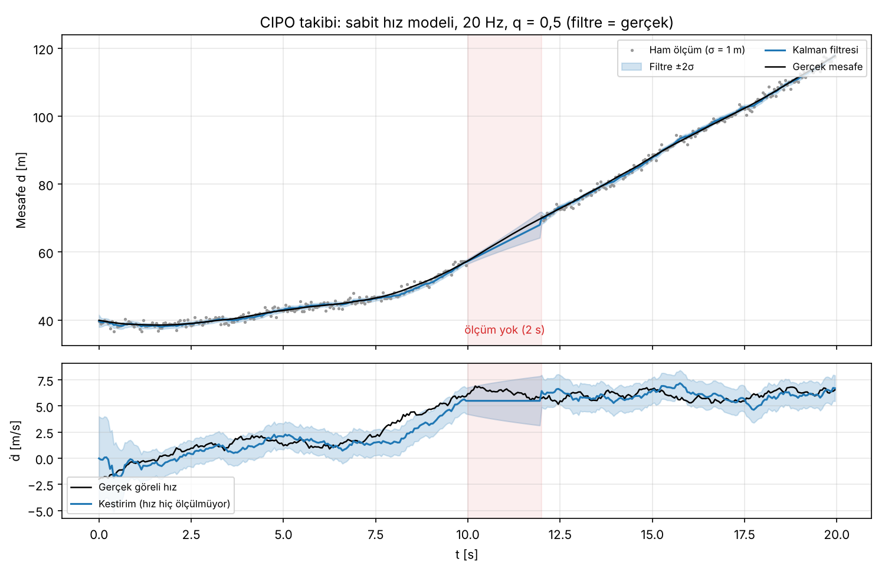
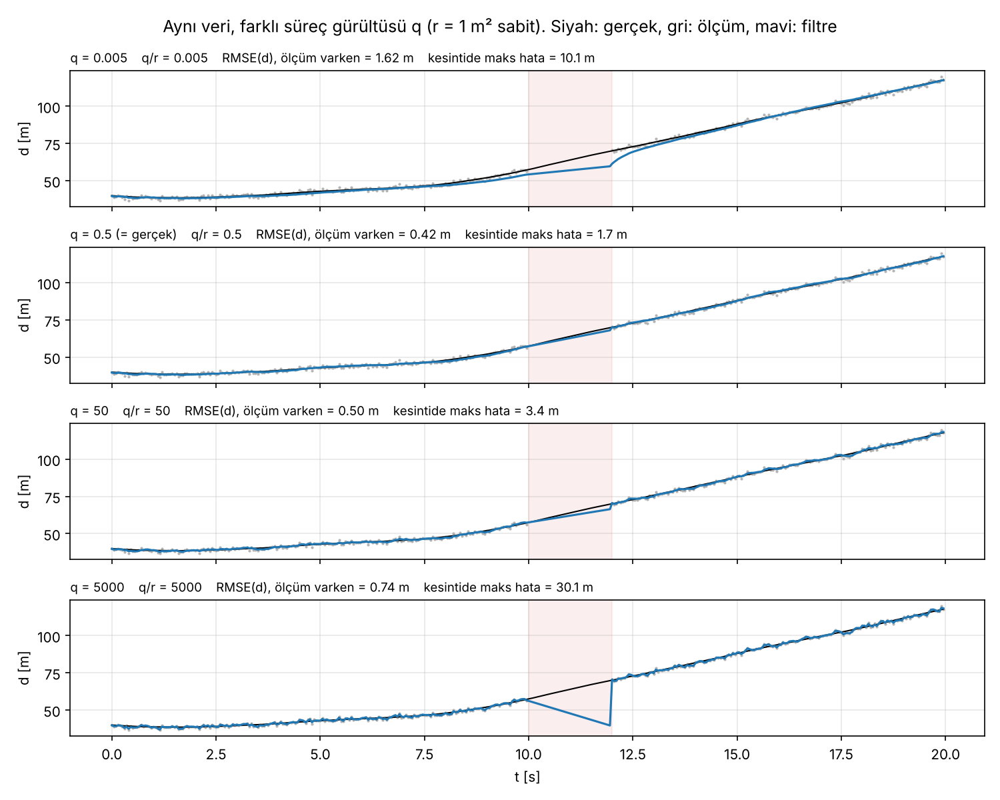
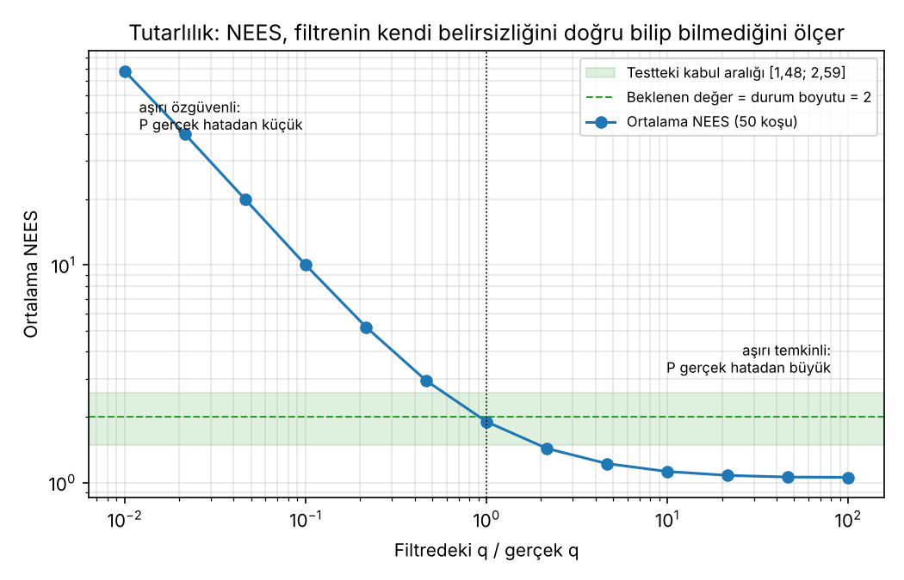

# 03 — Takip: Kalman Filtresi

## Öğrenme hedefi

Öğrenilmiş algının çıktısı **gürültülü ve aralıklı**dır: kareler arasında titrer,
bazen hiç gelmez. Kontrolcünün bu çıktıyı doğrudan kullanması direksiyonu titretir.
Bu modülde algı ile kontrol arasındaki katmanı yazıyorsun: lineer Kalman filtresi.

İki uygulama:
- **CIPO takibi**: öndeki aracın mesafesi ve göreli hızı `[d, ḋ]`, sabit hız modeli. ACC/AEB bunu kullanır.
- **Şerit takibi**: aracın şeride göre yanal hatası ve yön hatası `[e_y, e_ψ]`. LKAS ve 05 bunu kullanır.

Modül sonunda şunları açıklayabilmelisin:
- `Q` ile `R` oranı filtrenin "ölçüme mi modele mi güveneceğini" nasıl belirler?
- Ölçüm gelmediğinde (missed detection) ne yapılır ve kovaryans neden büyür?
- Filtrenin **tutarlı** olması ne demektir ve NEES bunu nasıl ölçer?

## Okumalar

- Thrun, Burgard, Fox, *Probabilistic Robotics*, Bölüm 3
- Bar-Shalom ve ark., *Estimation with Applications to Tracking and Navigation*: NEES ve tutarlılık testi bölümü

## Arayüz (`src/kalman.py`)

| Öğe | Görev |
|---|---|
| `KalmanFilter(x0, P0)` | `predict(F, Q)`, `update(z, H, R)`; `z is None` ise update atlanır |
| `cv_model(dt, q)` | CIPO için `F`, `Q` (sürekli beyaz ivme gürültüsü modeli) |
| `lane_model(dt, v, q_y, q_psi)` | Şerit için `F`, `Q`; `ė_y = v·e_ψ` |
| `nees(x_true, x_est, P)` | Normalize kestirim hata karesi |
| `src/plots.py` | 3 grafik + sayısal özet: `python 03-tracking/src/plots.py` (repo kökünden) |

## Görevler

- [x] `KalmanFilter` + `cv_model` → CIPO testleri
- [x] `lane_model` → şerit testi
- [x] `nees` → tutarlılık testi (Monte Carlo)
- [x] `results/cipo.png`: gerçek / ham ölçüm / filtre + ±2σ bandı, ölçüm kesintisi işaretli
- [x] `results/q_r_sweep.png`: `q` ∈ 4 değer için filtre çıktısı, aynı veriye
- [x] `notes.md`: yukarıdaki 3 soruya grafiklere dayanan cevaplar

## Sonuçlar

CIPO takibi, q = gerçek: ham ölçüm hatası 0,94 m → filtre 0,42 m. Göreli hız hiç ölçülmediği hâlde
0,77 m/s hatayla kestiriliyor. 2 s ölçüm kesintisinde σ_d 0,34 → 1,89 m'ye büyüyor, gerçek hata (1,74 m)
bandın içinde kalıyor.

Ek (tutarlılık sorusu için): 

Yorumlar ve 3 sorunun cevabı: [`notes.md`](notes.md).

## Kabul kriteri

- [x] `pytest 03-tracking` tamamen yeşil
- [x] 2 grafik üretilmiş, README'den link verilmiş
- [x] `notes.md`'de NEES testinin neden bir **aralık** kontrolü olduğu açıklanmış

## Yazı

→ `docs/writing-plan.md` #4
