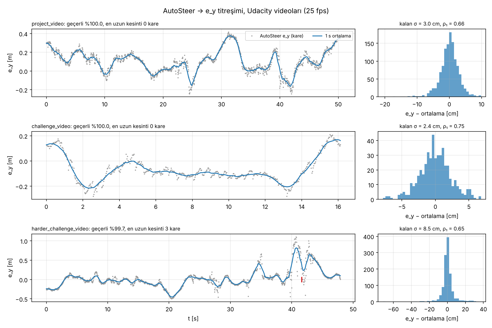
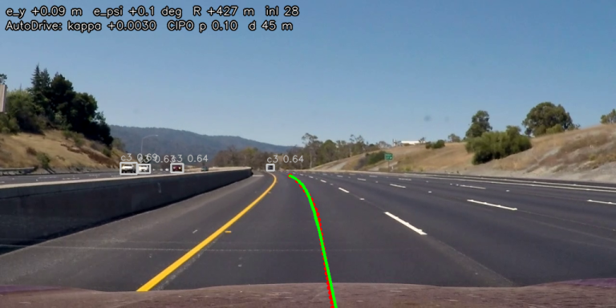
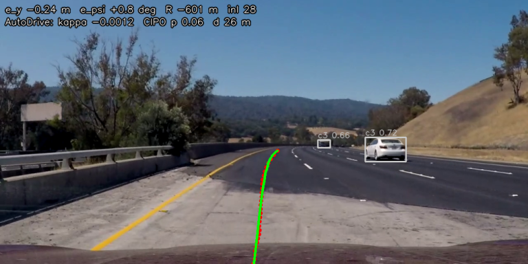
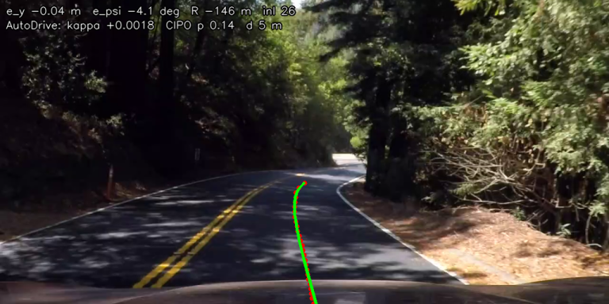
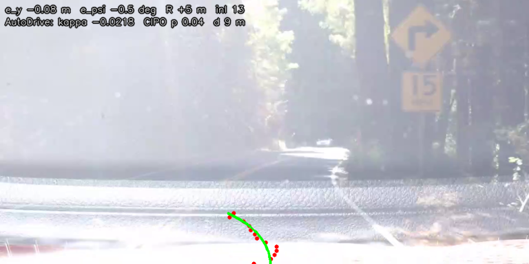
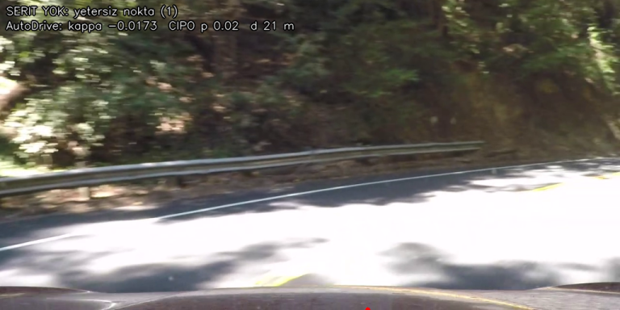
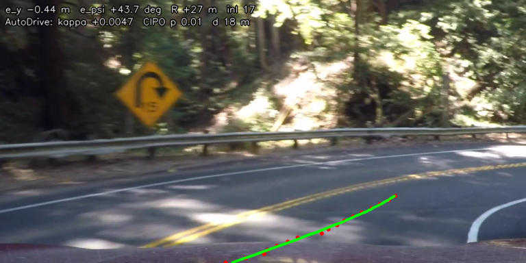
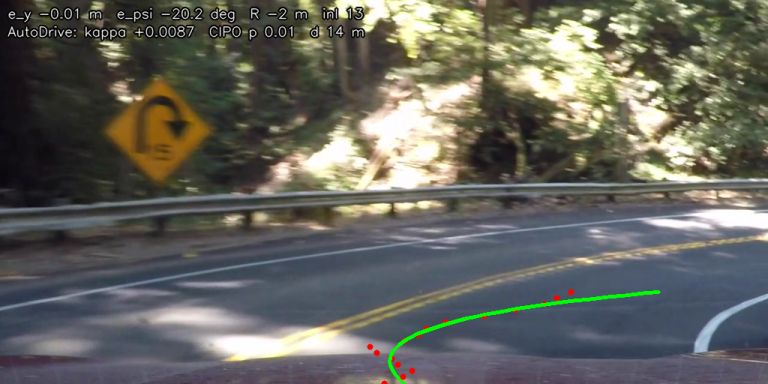
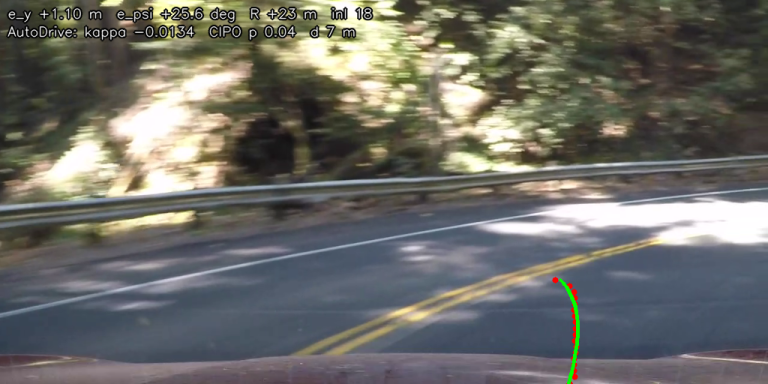

# 04 — Öğrenilmiş Algı: VisionPilot Modellerini Okumak

## Öğrenme hedefi

Bu modülde model eğitilmez. Hedef, mevcut açık kaynak modellerin **arayüzünü** ve
**sınırlarını** anlamaktır. Bir modelin ne aldığını, ne verdiğini, çıktısının
sonradan nasıl işlenip kontrolcünün kullanabileceği bir sayıya dönüştürüldüğünü
ve nerede bozulduğunu bilmek istiyoruz.

**Kapsam güncellemesi (Kas 2026):** Modül ilk yazıldığında odak EgoLanes + AutoSteer idi. VisionPilot 1.0
EgoLanes'i artık kullanmıyor (00 notları, 2. bölüm). Odak modeller:
- **AutoSteer**: tek kareden ego yolun 64 noktası (LKAS, LDW)
- **AutoDrive**: iki kareden CIPO mesafesi, CIPO olasılığı, yol eğriliği (ACC/AEB + yanal füzyon)
- **AutoSpeed**: tek kareden YOLO tarzı nesne kutuları, CIPO seviyesi sınıfları (ACC/FCW/AEB)

Bu modül, 05'teki **sentetik ölçüm modelinin** gerçekçi olmasını sağlar.

## Kurulum

Colab gerekmiyor; her şey CPU'da çalışıyor.

```bash
pip install -r requirements.txt -r 04-perception/requirements.txt
git clone --depth 1 https://github.com/autowarefoundation/autoware.privately-owned-vehicles.git ../vp
export VISIONPILOT_DIR=$(realpath ../vp)        # ağırlıklar: $VISIONPILOT_DIR/VisionPilot/modules/models/weights/*.onnx
git clone --depth 1 https://github.com/udacity/CarND-Advanced-Lane-Lines.git ../udacity   # test videoları
python 04-perception/src/run_video.py ../udacity/project_video.mp4      # → results/project_video.csv
python 04-perception/src/analyze.py                                     # → gürültü tablosu, results/noise.png
pytest 04-perception                                                    # ağırlık gerektirmez
```

Windows PowerShell'de `export` yerine `$env:VISIONPILOT_DIR = (Resolve-Path ..\vp)`.

- Model ağırlıkları ve videolar **repoya commit edilmez** (`.gitignore`: `*.onnx`, `videos/`).
- Lisanslar: VisionPilot ve ağırlıkları Apache 2.0; Udacity videoları MIT. Ayrıntı `notes.md`'de.
- Kullanılan sürüm: VisionPilot `65375ec2cf` (17 Kas 2026). Repo hızlı değişiyor; satır referansları bu commit'e göre.

## Arayüz (`src/`)

| Dosya / fonksiyon | Görev |
|---|---|
| `inspect_model.load_model(name)` | `autosteer`, `autodrive`, `autospeed` için onnxruntime oturumu |
| `inspect_model.preprocess(frame, calib)` | Ham kare → kırpılmış 1024×512 (AutoSteer/AutoSpeed) ve homografiyle warp edilmiş 1024×512 (AutoDrive), iki tensör |
| `inspect_model.infer(model, inputs)` | Ham çıktı |
| `inspect_model.postprocess(name, raw, calib)` | AutoSteer → RANSAC polinomu → `e_y`, `e_ψ`, `κ`; AutoDrive → mesafe, eğrilik, olasılık; AutoSpeed → NMS sonrası kutular |
| `inspect_model.overlay(frame, result, calib)` | Görselleştirme |
| `inspect_model.udacity_calibration()` | Udacity kamerası için piksel → zemin homografisi (nasıl kurulduğu docstring'de ve `notes.md`'de) |
| `run_video.py`, `analyze.py`, `dump_frames.py` | Videoyu işle, gürültüyü kestir, kare kaydet |
| `tests/test_postprocess.py` | Son işleme ve işaret kuralları (model gerektirmez) |

## Tensör tablosu

Satır referansları `VisionPilot/` altına göre. Şekiller onnxruntime ile de doğrulandı.

| Model | Giriş şekli | Normalizasyon | Çıkış şekli | Çıkışın anlamı | Kod referansı |
|---|---|---|---|---|---|
| AutoSteer | `input` [1, 3, 512, 1024] float32: ham kare üstten 2:1 kırpılır, 1024×512'ye `INTER_LINEAR` | BGR→RGB, /255, ortalama/std yok | `lane_value` [1, 1, 64, 1], `height` [1, 1, 64, 1] | `lane_value[i]·1024` = i. satırın (v = i·511/63) yol merkezinin x pikseli. `height ≥ 0,5` olan noktalar kullanılır (sigmoid yok, ham değer). Noktalar `H_resized` ile zemine izdüşürülür | `modules/common/include/common/utils.hpp:15-19`, `modules/sensing/image_preprocessing/src/image_preprocessor.cpp:18-21`, `modules/models/src/inference.cpp:49-68`, `modules/models/src/auto_steer.cpp:76,81`, `modules/safety_guardian/fusion/src/lateral_fusion.cpp:185-196` |
| AutoDrive | `image_prev`, `image_curr`, her biri [1, 3, 512, 1024]: ham kare `C` homografisiyle ZOD kanonik görünümüne warp edilir (`BORDER_REFLECT_101`) | BGR→RGB, /255, ImageNet ortalama (0,485; 0,456; 0,406) ve std (0,229; 0,224; 0,225), RGB sırası | `distance` [1, 1], `curvature` [1, 1], `flag_logit` [1, 1] | Mesafe = 150·(1 − d) m; eğrilik = 0,21·c 1/m; CIPO olasılığı = sigmoid(logit). Füzyon mesafeyi yalnız olasılık ≥ 0,40 iken kullanır | `image_preprocessor.cpp:13-14`, `inference.cpp:22-47,153-159`, `auto_drive.cpp:47-56,81-83`, `fusion/src/longitudinal_fusion.cpp:78`, `fusion/include/fusion/lateral_fusion.hpp:97-98` |
| AutoSpeed | `input` [1, 3, 512, 1024], AutoSteer ile aynı tensör | AutoSteer ile aynı | `output` [1, 8, 10752] | Kanal öncelikli: 0–3 kutu (cx, cy, w, h; 1024×512 piksel), 4–7 sınıf olasılığı. Sınıf 1 = CIPO L1 (aynı şerit), 2 = L2 (komşu, araya girebilir); 0 ve 3 kullanılmıyor. Eşik 0,6, sınıf-bağımsız NMS IoU 0,45. **Model sigmoid'i içinde uyguluyor, C++ ikinci kez uyguluyor** (notes.md) | `auto_speed.cpp:98-203` (sigmoid: `:139`), `auto_speed.hpp:57-58`, `longitudinal_fusion.cpp:183-216` |

## Görevler

- [x] VisionPilot'ta AutoSteer, AutoDrive, AutoSpeed için inference kodunu bul; dosya yollarını `notes.md`'ye yaz
- [x] Giriş/çıkış tensör şekillerini, normalizasyonu ve renk sırasını **koddan** belgele (dosya:satır referansıyla)
- [x] Lisansı uygun bir açık sürüş videosu üzerinde modelleri çalıştır
- [x] `results/overlay_*.png`: en az 3 iyi kare
- [x] `results/failures/`: en az 5 başarısızlık karesi
- [x] CPU'da kare başına süreyi ölç (donanım `notes.md`'de)
- [x] Model çıktısından kontrolcünün kullandığı `e_y`, `e_ψ`'ye giden yolu (postprocess) adım adım `notes.md`'de anlat

## Kabul kriteri

- [x] Tensör tablosu dolu ve her satırda kod referansı var
- [x] 5 başarısızlık karesinin her birine bir cümlelik **neden** tahmini yazılmış
- [x] Ölçülen `e_y` titreşiminden 05 için gürültü std ve kayıp oranı tahmini çıkarılmış (sayı + nasıl ölçtüğün)

## Sonuçlar

Udacity videoları (2943 kare), Xeon 2,1 GHz CPU:

| | Otoyol (project) | Zor yol (harder_challenge) |
|---|---|---|
| Geçerli şerit | %100 | %99,7 |
| e_y titreşimi σ (1 s ortalamaya göre) | 3,0 cm | 8,5 cm (firkete hariç 4,8 cm) |
| e_ψ titreşimi σ | 0,32° | 3,2° |
| Kareler arası ilişki ρ₁ | 0,66 | 0,65 |

Üç model sırayla: kare başına ~234 ms (≈ 4,3 Hz; VisionPilot'un hedefi 10 Hz). INT8 bu CPU'da hızlandırmıyor.

**Bulgular:** 05'in gürültü varsayımı otoyolda ~10 kat kötümser ama gerçek hatalar ilişkili ve sistematik
(firkete, parlama); keskin virajda bozulmanın yarısı modelden değil 2. derece polinomlu son işlemeden geliyor;
VisionPilot'un C++ kodu AutoSpeed'in zaten sigmoid'li çıktısına ikinci kez sigmoid uyguluyor. Ayrıntılar
[`notes.md`](notes.md).



İyi kareler:





Başarısızlık kareleri (nedenleri `notes.md`'de):

| | |
|---|---|
|  |  |
|  |  |
|  | |

## Yazı

→ `docs/writing-plan.md` #5 (05 ile birlikte)
