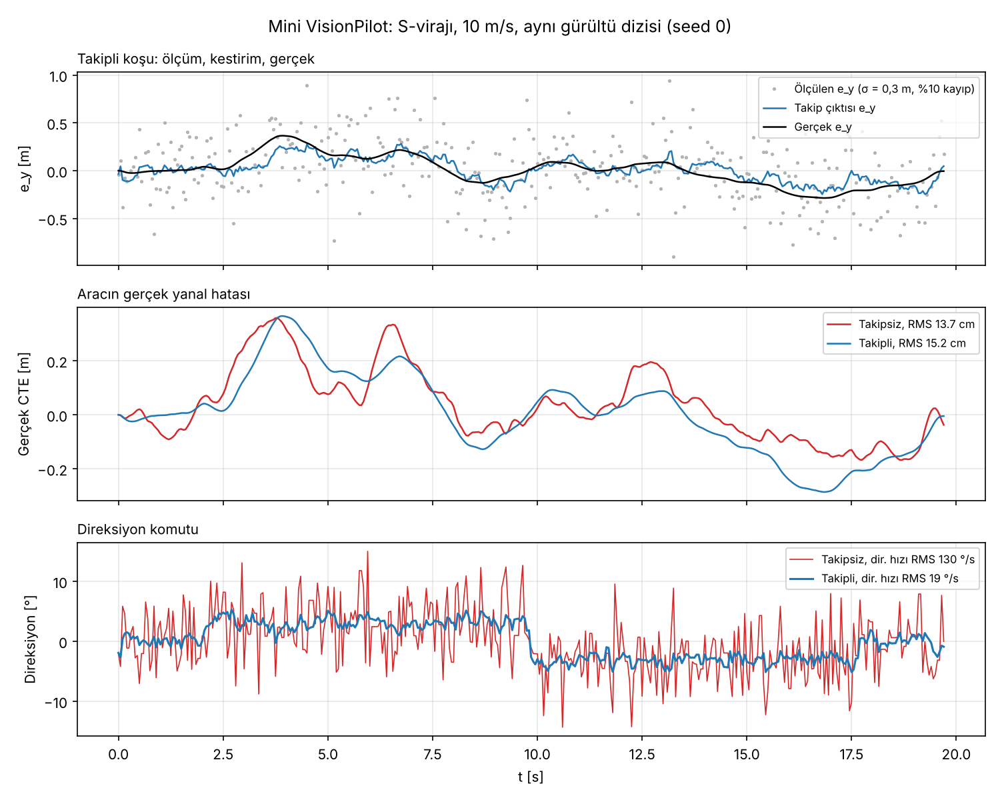
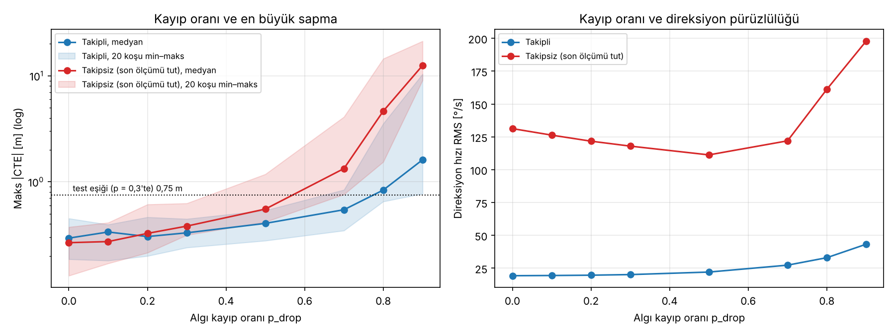
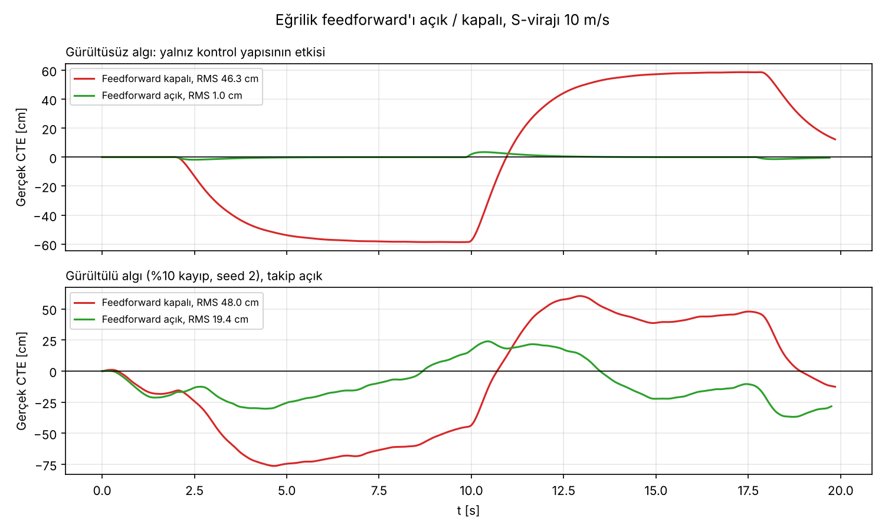
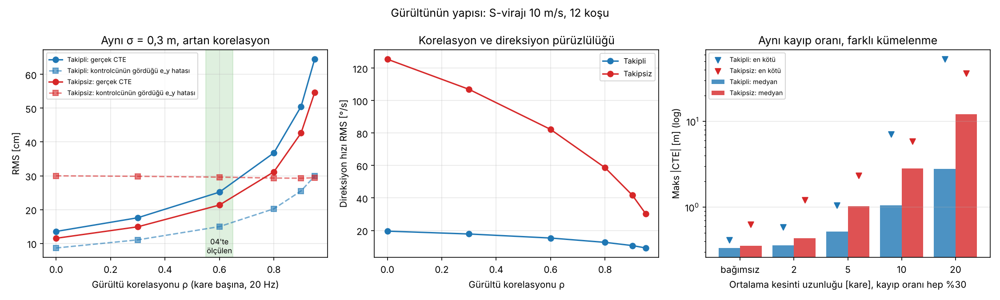
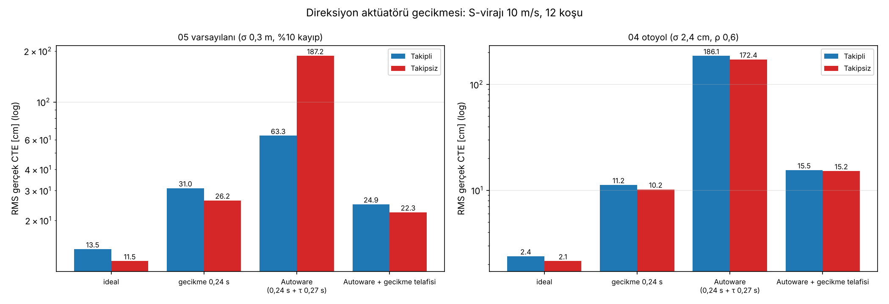

# 05 — Entegrasyon: Mini VisionPilot

## Öğrenme hedefi

Önceki modülleri tek bir kapalı çevrimde birleştirmek:

```
araç modeli (01) ──durum──▶ sentetik algı ──z (gürültülü, aralıklı)──▶ takip (03) ──x̂──▶ şerit tutma kontrolü ──δ──▶ araç modeli
```

Gerçek bir kamera yerine **sentetik algı** kullanılır: simülasyondaki gerçek durumdan
`[e_y, e_ψ, κ]` hesaplanır, üstüne gürültü ve kayıp eklenir. Gürültü değerlerini 04'te
gözlemlediklerine göre ayarla. Bu yapı, VisionPilot'un "öğrenilmiş algı + klasik takip +
feedforward/feedback kontrol" fikrinin oyuncak bir kopyasıdır.

Modül sonunda şunları açıklayabilmelisin:
- Takip katmanı kaldırılınca ne bozulur: yanal hata mı, direksiyon pürüzsüzlüğü mü? Neden?
- Eğrilik feedforward'ı hangi hatayı ortadan kaldırır?
- Algı kaybı oranı arttıkça sistem nerede ve nasıl çöker?

## İşaret kuralları

- `e_y`: yanal hata, yol yönüne göre sol pozitif (`common` ile aynı)
- `e_ψ = yaw_araç − yaw_yol`
- `κ`: yol eğriliği, sola dönüş pozitif

## Arayüz

| Dosya | İçerik |
|---|---|
| `src/perception_sim.py` | `measure_lane(state, path, rng, noise, p_drop)` → `z` veya `None` |
| `src/lane_keeping.py` | `LaneTracker` (03'ün `KalmanFilter`'ını kullanır, 3 durumlu model senin), `lane_keep_steer(...)` |
| `src/plots.py` | 3 grafik + sayısal özet: `python 05-integration/src/plots.py` (repo kökünden) |
| `src/actuator_delay.py` | Ek: direksiyon gecikmesi (0,24 s + τ 0,27 s) → `results/actuator_delay.png` |
| `src/noise_structure.py` | Ek: ilişkili gürültü (AR(1)) ve kümeli kayıp deneyleri → `results/noise_structure.png` |
| `src/loop.py` | `run(path, v, noise, p_drop, use_tracker, seed)` → zaman, durumlar, direksiyon, gerçek CTE |

## Görevler

- [x] Sentetik algı + kayıp
- [x] 3 durumlu şerit modeli `[e_y, e_ψ, κ]`, direksiyonu girdi olarak kullanan tahmin adımı
- [x] Feedforward (`κ`'dan) + feedback (`e_y`, `e_ψ`'den) direksiyon
- [x] `results/closed_loop.png`: tracker'lı / tracker'sız CTE ve direksiyon, alt alta
- [x] `results/dropout_sweep.png`: kayıp oranı ∈ {0, 0.1, 0.2, 0.3, 0.5} vs maks |CTE| (çöküşü göstermek için 0.7, 0.8, 0.9 da eklendi)
- [x] `results/ff_ablation.png`: feedforward açık/kapalı
- [x] `notes.md`: 3 soruya grafiklere dayanan cevaplar ve VisionPilot mimarisiyle karşılaştırma (00'daki diyagrama atıf)

## Sonuçlar

| %10 kayıp, seed 0 | Gerçek CTE RMS | Direksiyon hızı RMS |
|---|---|---|
| Takipsiz | 13,7 cm | 130 °/s |
| Takipli | 15,2 cm | 19 °/s |

Takip katmanı düşük kayıpta yanal hatayı değil direksiyonu düzeltiyor (araç zaten hızlı gürültüyü
süzüyor). Yüksek kayıpta ise sistemi ayakta tutan o: p = 0,8'de medyan maks sapma takipli 0,84 m,
takipsiz 4,6 m. Feedforward virajdaki 58 cm'lik kalıcı sapmayı 3,5 cm'e indiriyor.







Ek: gürültünün yapısı. Aynı σ ile 04'te ölçülen korelasyon (ρ ≈ 0,6) yanal hatayı ~2 katına çıkarıyor ve takip
katmanı bunu silemiyor; aynı %30 kayıp 1 s'lik kesintiler hâlinde gelirse araç şeritten çıkıyor.



Ek: Autoware'in direksiyon gecikmesi değerleriyle (0,24 s + 0,27 s) bu kontrolcü kararsızlaşıyor; takip katmanı bunu çözmüyor, gecikme telafisi çözüyor (173 → 15 cm).



Yorumlar, 3 sorunun cevabı, 04 ölçümleriyle karşılaştırma ve VisionPilot'tan 8 fark: [`notes.md`](notes.md).

## Kabul kriteri

- [x] `pytest 05-integration` tamamen yeşil
- [x] 3 grafik üretilmiş, README'den link verilmiş
- [x] `notes.md`'de modelin VisionPilot'tan **nerede farklı olduğu** en az 3 maddeyle yazılmış (dürüstlük bölümü)

## Yazı

→ `docs/writing-plan.md` #5
