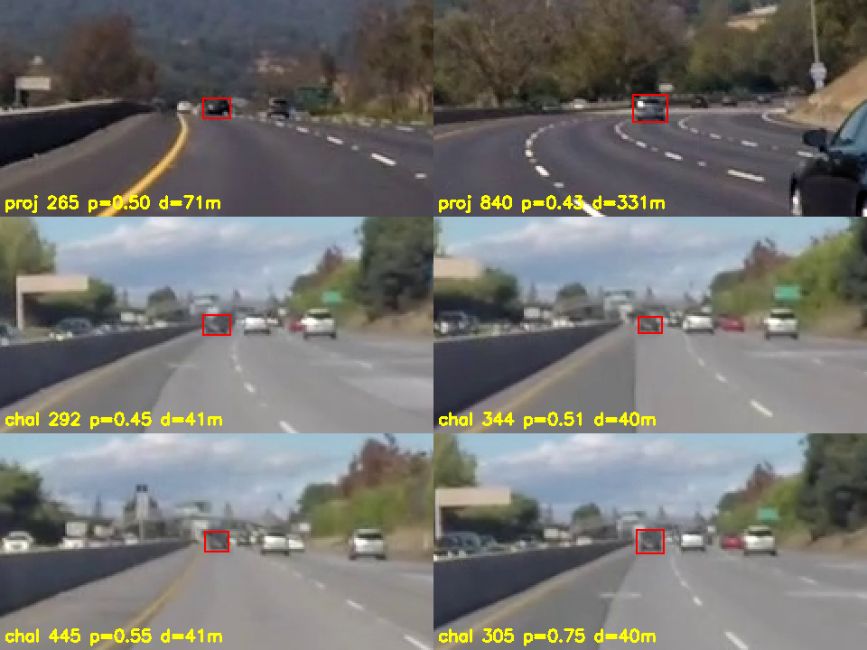
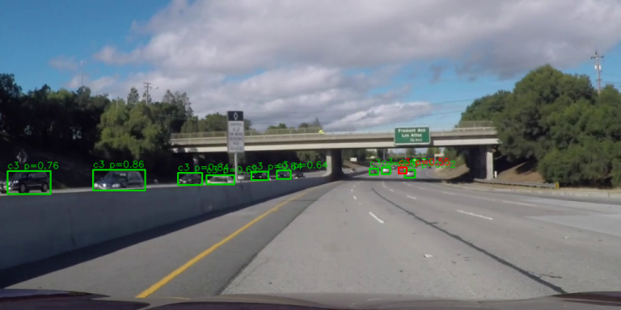

# Gönderim rehberi

Taslakları senin adına gönderemedim: `autowarefoundation/autoware.privately-owned-vehicles` reposuna bu oturumun yazma
yetkisi yok (Claude GitHub uygulaması o organizasyonda kurulu değil; kurulum organizasyon sahiplerinin kararı).
Aşağıdaki adımlar senin kendi GitHub hesabınla, tarayıcıdan ve kendi bilgisayarında yapılacak şekilde hazırlandı.

Kontroller (20 Kas 2026): upstream `main` hâlâ `65375ec2`, `auto_speed` hâlâ `b62e55b`; taslaklardaki satır
referansları geçerli. `auto_speed`'de "sigmoid" geçen issue/PR yok. `autoware.privately-owned-vehicles`'da arama
yapamadım: göndermeden önce Issues sekmesinde "sigmoid", "conf_thres", "dt" diye ara.

Önerilen sıra: **1 → 2 → 3.** Yorum PR'ı küçük ve tartışmasız; projeyi ve ekibi tanımak için iyi bir başlangıç.

Metinlerin sonundaki "Drafted with Claude Code" satırı şeffaflık için; istersen silebilirsin.

---

## 1. Yorum düzeltmeleri: PR

Dosya: [`stale-comments.patch`](stale-comments.patch) (upstream `main` üzerinde oluşturuldu, sadece yorumlar, 4 dosya).

1. GitHub'da https://github.com/autowarefoundation/autoware.privately-owned-vehicles → **Fork**.
2. Kendi bilgisayarında:

```bash
git clone https://github.com/<kullanici-adin>/autoware.privately-owned-vehicles.git
cd autoware.privately-owned-vehicles
git checkout -b docs/fix-stale-comments
git am /yol/av-study/docs/contributions/stale-comments.patch
git commit --amend --no-edit --reset-author --signoff
git push -u origin docs/fix-stale-comments
```

   `--reset-author` commit'i senin adına yazar (patch'teki yer tutucu yazar silinir); `--signoff` repodaki commit'lerin
   kullandığı `Signed-off-by` satırını ekler.
3. GitHub'ın gösterdiği **Compare & pull request** düğmesi → başlık ve açıklama için
   [`stale-comments-pr.md`](stale-comments-pr.md) içindeki "PR açıklaması (İngilizce)" bölümünü yapıştır.

---

## 2. AutoSpeed çift sigmoid: issue

Yeni issue: https://github.com/autowarefoundation/autoware.privately-owned-vehicles/issues/new

**Title:**

```
AutoSpeed: sigmoid applied twice to class scores in post-processing (effective threshold is 0.405, not 0.6)
```

**Body** (görseller av-study'den linkli, yükleme gerekmez):

````markdown
### Summary

The AutoSpeed ONNX model already outputs class **probabilities** (the detection head applies `sigmoid` in eval mode),
but the VisionPilot C++ post-processing applies `sigmoid` again before comparing with `conf_thres = 0.6`. Because
sigmoid is monotonic, `sigmoid(p) >= 0.6` is equivalent to `p >= ln(0.6/0.4) ≈ 0.405`. So the configured threshold of
0.6 behaves like a probability threshold of ~0.405, and all reported scores are compressed into [0.5, 0.731].

The same double sigmoid exists in the Python inference code of `auto_speed`, so the C++ port faithfully reproduces it.
The training/validation code, however, treats the outputs as probabilities without an extra sigmoid.

I am not proposing to change the detection behaviour (see measurements below, the lower effective threshold seems to
help with distant CIPOs). I am proposing to make the threshold mean what it says.

### Evidence

Versions: `autoware.privately-owned-vehicles` @ `65375ec2cf` (also checked on `main` as of 2026-11-19),
`auto_speed` @ `b62e55b93b`.

1. **The model outputs probabilities.**
   - `auto_speed/Models/model_components/auto_speed/auto_speed_head.py:66`:
     `return torch.cat(tensors=(box * self.strides, cls.sigmoid()), dim=1)` (eval mode).
   - The shipped `VisionPilot/modules/models/weights/autospeed_fp32.onnx` ends with
     `Concat(Mul(box), Sigmoid(cls))`; class channels 4–7 are in [0, 1].
2. **Training/validation uses them as probabilities.** `auto_speed/Models/training/auto_speed_util.py:124`
   (`non_max_suppression`, `confidence_threshold=0.001`) thresholds `outputs[:, 4:]` directly; called from
   `auto_speed_trainer.py:495`. The INT8 QDQ evaluation (`exports/quantization/auto_speed_qdq.py:227`) does the same.
3. **Inference applies sigmoid again.**
   - VisionPilot C++: `VisionPilot/modules/models/src/auto_speed.cpp:139`
     `const float prob = 1.f / (1.f + std::exp(-data[(4 + c) * N + n]));`, compared at `:147` with `conf_thres`
     (default 0.6, `include/models/auto_speed.hpp:57`; the comment at `:54` calls it a "sigmoid class probability threshold").
   - `auto_speed/Models/inference/auto_speed_infer.py:69`: `torch.max(class_probs.sigmoid(), dim=1)`, `conf_thres=0.6`.
   - `auto_speed/Models/visualizations/video_visualization.py:69`: `1 / (1 + np.exp(-class_probs))`, `conf_thres=0.6`.
4. Downstream, the score is only used for the threshold and NMS ordering (`longitudinal_fusion.cpp` uses class and box),
   so NMS results are identical between "double sigmoid + 0.6" and "single sigmoid + 0.405".

### Measured impact

I re-implemented the VisionPilot pre/post-processing in Python (onnxruntime, CPU) and ran AutoSpeed on two public dashcam
clips (Udacity `CarND-Advanced-Lane-Lines`, MIT licence, 1280×720, camera HFOV ≈ 58°, calibrated with my own ground
homography). "Current" = double sigmoid at 0.6 (= p ≥ 0.405); "probability 0.6" = no extra sigmoid at 0.6.

| Clip | Frames | Boxes, current / prob. 0.6 | Frames with a CIPO (class 1/2), current / prob. 0.6 |
|---|---|---|---|
| project_video (highway) | 1260 | 3506 / 2735 | 10 / 0 |
| challenge_video (highway) | 484 | 3378 / 2530 | 109 / 25 |

Inspecting the CIPOs that only pass at the current (lower) effective threshold: they are small (13–19 px wide) but real
vehicles in the ego lane, about 40–70 m ahead (crops attached). So simply removing the extra sigmoid while keeping 0.6
would reduce CIPO recall on these clips. I did not have labels, so I could not measure precision/recall properly.





Scripts: [autospeed_threshold.py](https://github.com/zelihaguven/av-study/blob/main/04-perception/src/autospeed_threshold.py), Python port of the pre/post-processing: [inspect_model.py](https://github.com/zelihaguven/av-study/blob/main/04-perception/src/inspect_model.py).

### Suggested fix

Option A (keeps current behaviour, fixes semantics; my suggestion):
- Remove the extra sigmoid in `auto_speed.cpp:139` (use the probability directly).
- Set the default `conf_thres` to `0.4` (≈ the current effective value 0.405) and update the comment.
- Apply the same change to `auto_speed_infer.py:69` and `video_visualization.py:69` in `auto_speed`.

Option B (if 0.6 on probabilities was the original intent):
- Remove the extra sigmoid and keep 0.6, accepting fewer detections, ideally after validating on labelled data that
  the drop is mostly false positives.

Either way, the reported scores become real probabilities, which matters for anyone tuning thresholds or using the
score downstream (e.g. weighting the AutoSpeed measurement in the longitudinal fusion).

Happy to open a PR for Option A if that direction sounds right. Which threshold was intended?

---
_Drafted with [Claude Code](https://claude.ai/code)_
````

İstersen aynı konuyu `auto_speed` reposuna da kısaca bildir: https://github.com/autowarefoundation/auto_speed/issues/new
("Same double sigmoid in Models/inference/auto_speed_infer.py:69 and visualizations/video_visualization.py:69, see
<1. issue linki>").

---

## 3. Kontrol periyodu: önce soru, sonra issue

Bu taslağın güveni daha düşük (C++'ı çalıştırmadım). Önerim önce PoV WG'ye soru olarak sormak:
https://github.com/autowarefoundation/autoware.privately-owned-vehicles/discussions (Discussions açık değilse issue olarak aç).

**Title:**

```
planning: `dt = 0.05` ("50Hz control period") does not match the actual planning loop period
```

**Body:**

````markdown
### Summary

`VisionPilot/modules/safety_guardian/planning/include/planning/config.hpp` defines

```cpp
// 50Hz control period — used by planning.cpp
inline constexpr double dt = 0.05;
```

0.05 s is 20 Hz, not 50 Hz. More importantly, the planner is called once per camera frame
(`app/vision_pilot.cpp`, `planner.compute_plan(...)`), so the real cycle period is set by the input source
(`source.v4l2_fps = 10` by default, or the video file's FPS), not by `dt`.

### Where `dt` matters

- `planning.cpp:41-42`: `ds_cycle = v * dt; raw_dkappa_ds = (kappa - prev_kappa_) / ds_cycle;`
  `dkappa_ds` is the spatial rate of curvature change between consecutive cycles. It sets the cubic term of the
  MPC reference curve (`c3 = dkappa_ds / 6`, `planning.cpp:79`) and therefore the curvature schedule over the
  10 m horizon. If the loop actually runs at 10 Hz, the travelled distance is `v * 0.1`, so `dkappa_ds` is
  overestimated by 2× (before the `RATE_MAX = 0.15` clamp and the EMA). At 30 FPS video input it is underestimated
  by 1.5×.
- `planning.cpp:54-66`: `v_schedule` is propagated with `dt` over `N = 20` steps, while the MPC steps are spatial
  (`DS = 0.5` m, i.e. `DS / v` seconds per step). Today only `v_schedule[0]` is read
  (`lateral_planning.cpp:40,132`), so this has no effect yet, but it will if the full schedule is used later.

### History (for context)

- `18dfb192` (2026-06-11): `double dt = 0.05;` introduced as the time step of the original MPC (N = 20, 1 s horizon).
- `8f9907e0` (2026-07-24): MPC became spatial; `dt` kept with the comment `// 50Hz control period — still used by planning.cpp`.
- `0b0ae12e` (2026-11-16): moved to `config.hpp` in the MISRA refactor.

### Suggested fix

1. Pass the elapsed time since the previous plan (e.g. from frame timestamps) into `compute_plan` and use it for
   `ds_cycle`; keep a lower bound for robustness. Alternatively, accumulate odometry distance directly.
2. If a fixed period is intended, derive it from the configured camera rate and fix the comment (0.05 s = 20 Hz).
3. For `v_schedule`, step by `DS / max(v, v_min)` so that index `i` corresponds to the spatial step `i * DS`.

Related: the fusion modules also assume a fixed nominal `dt = 0.10` (`lateral_fusion` / `longitudinal_fusion`
defaults; `update()` is called without a dt in `inference.cpp:207`). A single source of truth for the cycle time
would make both consistent.

Question for maintainers: what is the intended planning/control rate for VisionPilot 1.0 (10 Hz like the fusion, or faster)?

---
_Drafted with [Claude Code](https://claude.ai/code)_
````
